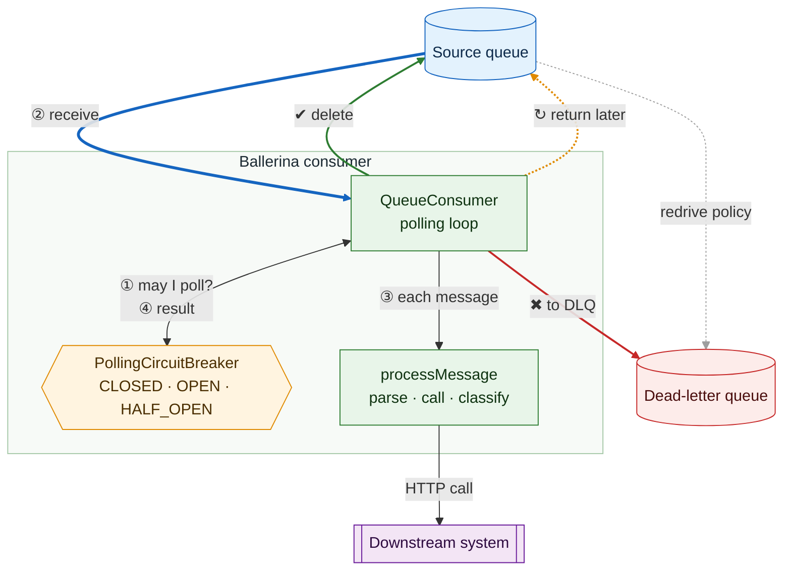
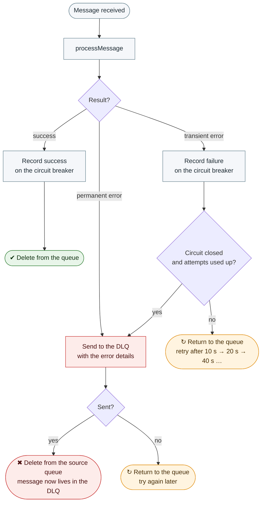
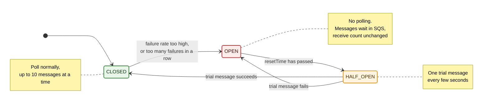
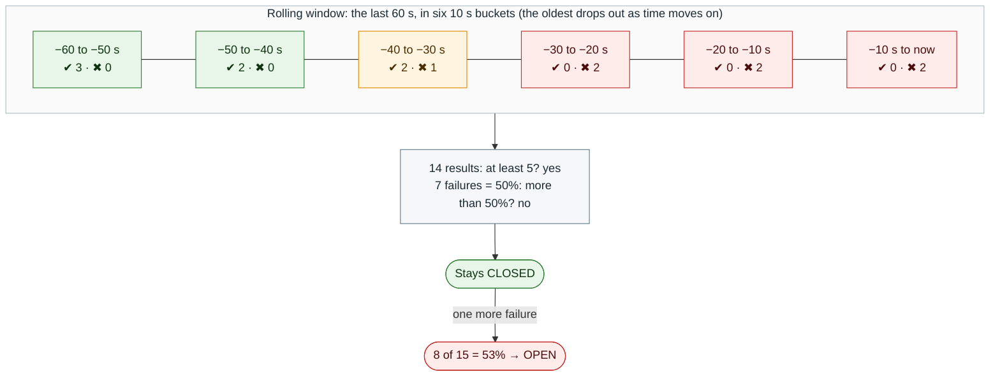
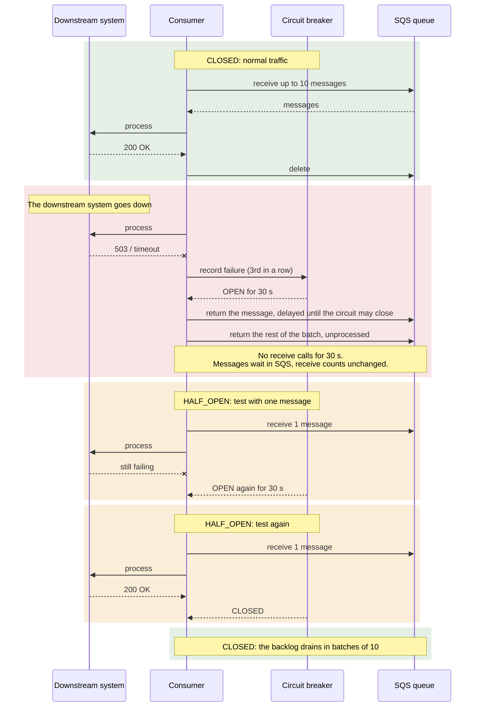
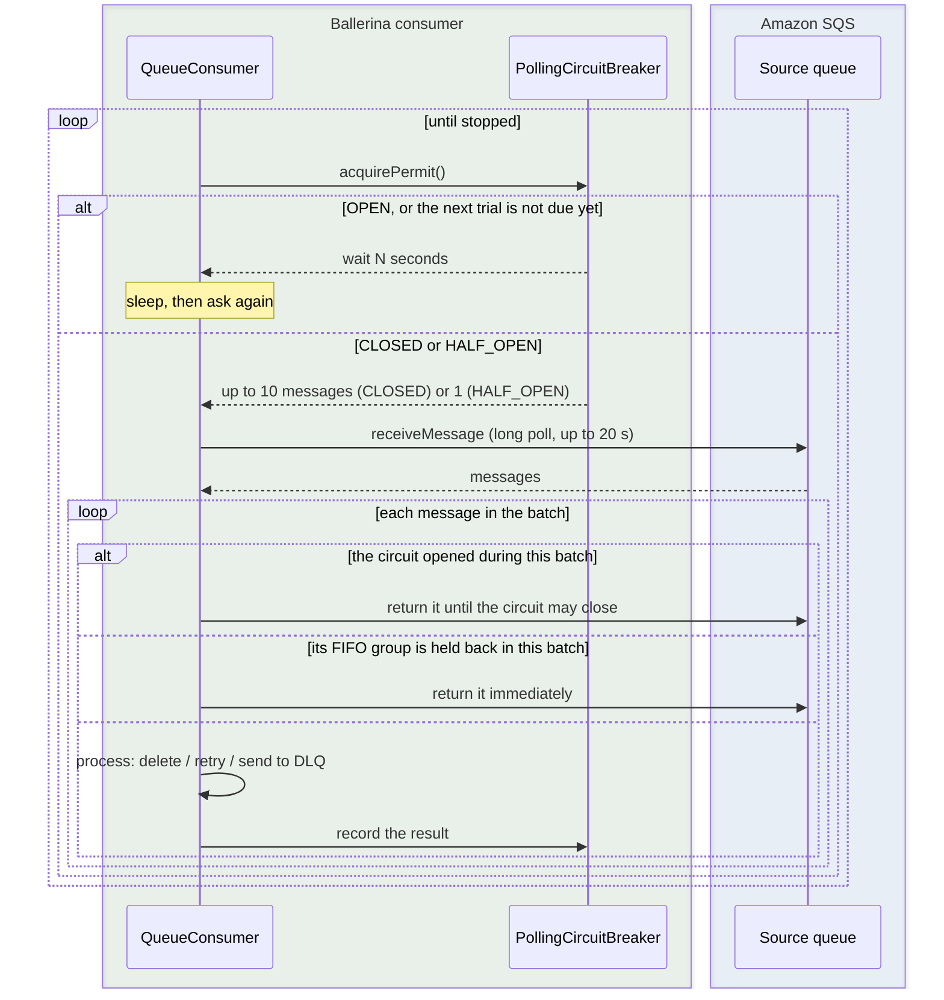
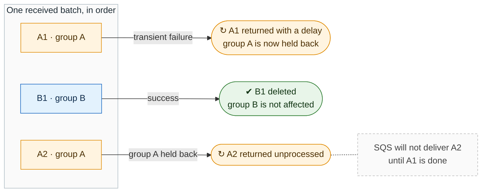

# Circuit Breaker for an Amazon SQS Consumer in Ballerina

This sample shows how to protect an Amazon SQS consumer from an unavailable downstream system by combining four techniques:

- **Error classification:** every failure is either *transient* (retry later) or *permanent* (retrying will not help).
- **Retries through SQS:** a transient failure returns the message to the queue with a growing delay, using the message visibility timeout.
- **A dead-letter queue (DLQ):** permanent failures, and messages that keep failing, are moved to a DLQ together with the reason.
- **A circuit breaker that controls polling:** when the downstream system is down, the consumer stops receiving messages until it recovers.

It is a reference implementation of the pattern, written to be read and adapted. Replace the message type, the downstream call and the error mapping with your own.

## Why the circuit breaker controls polling

An HTTP client circuit breaker (`http:CircuitBreakerConfig`) only makes outgoing calls fail fast. The consumer still receives messages, every receive increases the message's receive count, and during a long outage the queue's redrive policy moves perfectly good messages to the DLQ.

Here the circuit breaker sits in front of `receiveMessage` instead. While it is open, nothing is received: messages stay in the queue and their receive count does not change.

The sample uses `sqs:Client` in a hand-written loop rather than `sqs:Listener`, because the listener cannot be paused and resumed, and pausing is what the circuit breaker needs to do.

## Architecture



| File | Contents |
|---|---|
| `consumer.bal` | `QueueConsumer`: the polling loop and what happens to each message |
| `circuit_breaker.bal` | `PollingCircuitBreaker`: the state machine; it knows nothing about SQS |
| `processor.bal` | `processMessage`: your business logic, and how each failure is classified |
| `types.bal` | Settings with their defaults, error types, and the example message type |
| `main.bal` | Configuration and startup |

## How it works

### 1. Error classification

`processMessage` returns `()` on success, or one of two error types. The circuit breaker counts only transient errors, because a broken message says nothing about the downstream system's health.

| Failure | Example | Type | Retried | Counted by the circuit breaker |
|---|---|---|---|---|
| Invalid message | Not JSON, missing field, empty body, `orderId` with characters other than letters, digits, `_` and `-` | Permanent | No, to the DLQ | No |
| Request rejected | HTTP 400, 404, 409, 422 | Permanent | No, to the DLQ | No |
| Overloaded or slow | HTTP 408, 429 | Transient | Yes | Yes |
| Server error | HTTP 5xx | Transient | Yes | Yes |
| Network | Timeout, connection refused, DNS | Transient | Yes | Yes |
| Not authorised | HTTP 401, 403 | Transient | Yes | Yes |
| Redirect | HTTP 3xx (redirects are not followed) | Transient | Yes | Yes |
| Duplicate | Already processed (idempotency key) | Success | Deleted | Counts as success |

`OrderEvent` is an open record, so fields that producers add later are accepted, and forwarded to the downstream system, instead of failing every message. `orderId` is checked before it is used in the request path, because the HTTP client does not percent-encode path segments.

Add business-rule failures (for example "order already closed") to `processMessage` as `PermanentError`, and adjust `classifyStatus` to the way your downstream API reports errors and duplicates.

### 2. What happens to each message



- **Retry delay:** `retryBaseDelaySeconds`, multiplied by `retryBackOffFactor` on every further attempt (with the defaults: 10 s, 20 s, 40 s, ...), up to `retryMaxDelaySeconds`. The attempt number comes from the message's `ApproximateReceiveCount`.
- **Out of retries:** after `maxAttempts` receives, a message that keeps failing goes to the DLQ, but **only while the circuit is closed**. During an outage every message fails, which says nothing about the message itself, so it waits in the queue instead. `maxAttempts` is a receive budget, not a count of processing attempts: half-open trials and messages returned unprocessed use it up too. After an outage, a message can therefore reach the DLQ after fewer real attempts, possibly one. See [Making the numbers fit together](#making-the-numbers-fit-together).
- **Nothing is lost:** a message is deleted from the source queue only after it has been sent to the DLQ successfully.

### 3. Circuit breaker states



| State | Polling |
|---|---|
| `CLOSED` | Normal: up to `maxBatchSize` messages per receive |
| `OPEN` | None for `resetTime` seconds. Messages stay in SQS and their receive count does not grow |
| `HALF_OPEN` | One trial message at a time, at most one every `halfOpenTrialInterval` seconds |

The circuit opens when **either** rule is met:

1. **Failure rate:** over a rolling window of `timeWindow` seconds, at least `requestVolumeThreshold` results were recorded and more than `failureThreshold` of them were failures. This is the same model as Ballerina's HTTP circuit breaker, and it catches a system that fails intermittently.
2. **Failures in a row:** `consecutiveFailureThreshold` transient failures without a success in between, however slowly they arrive. This covers quiet queues, where the rolling window may never collect enough results. For example, a single message retried at 0, 10, 30, 70 and 150 s never puts more than 3 failures into a 60 s window.

How the rolling window counts, with the default settings (a 60 s window of six 10 s buckets):



The example shows the failure-rate rule on its own. With the default settings, the failures-in-a-row rule would usually have opened the circuit already, at the third failure in a row.

The circuit breaker keeps its own timer, so it moves from open to half-open even though nothing is being polled. When it closes, all counts are cleared, so failures from before the outage cannot reopen it straight away.

### An outage, step by step



### 4. The polling loop



### 5. FIFO queues

- **Order within a group:** if a message is returned for retry, the later messages of the same message group in that batch are returned too, without being processed. SQS does not hand out a group's later messages while an earlier one is still hidden, so the order is kept.


- **Moving a message to the DLQ does not block its group.** Later messages for the same group continue. If your messages depend on each other (for example "create" followed by "update"), see [Extending the pattern](#extending-the-pattern).
- **FIFO DLQ:** the message keeps its original group ID, and the original message ID is used as the deduplication ID.

### 6. The dead-letter queue

Two paths lead to the same DLQ:

1. **The consumer**, for permanent errors and for messages out of retries. The message is enriched with the failure details.
2. **The queue's redrive policy**, as a safety net for failures the consumer could not handle itself (crashes, failed DLQ sends, messages that keep timing out).

Each message the consumer sends to the DLQ carries these message attributes, so it can be traced back to its error and its logs:

| Attribute | Content |
|---|---|
| `errorCode` | e.g. `INVALID_PAYLOAD`, `HTTP_503`, `NETWORK` |
| `errorReason` | `PERMANENT` or `RETRIES_EXHAUSTED` |
| `errorMessage` | The error message, cut to 256 characters |
| `affectedSystem` | `consumer`, or the downstream system's name |
| `correlationId` | From the producer's `correlationId` attribute, or else the SQS message ID |
| `sourceQueueUrl` | The queue the message came from |
| `originalMessageId` | The message ID in the source queue |
| `receiveCount` | How many times the message had been received |

This uses 8 of the 10 message attributes SQS allows.

- **Producer attributes are not carried over.** The DLQ message gets these 8 attributes only; anything else the producer set (for example `tenantId` or `traceparent`) is dropped. `correlationId` survives because the consumer sets it again. If replay depends on other attributes, copy them in `moveToDlq` (at most 2 fit) or merge the error details into fewer attributes.
- **Size limit:** SQS counts attribute names, types and values toward the maximum message size. If the body plus the attributes exceed `maxMessageSizeBytes`, `errorMessage` and then `sourceQueueUrl` are dropped so the message still fits. If it still does not fit, the send fails and the redrive policy moves the message without error details.

## Assumptions

The sample makes these assumptions. Check each one against your system and change the code where it does not hold.

1. **One downstream system per consumer.** One circuit breaker protects one downstream system. If one queue holds messages for several systems, an outage in one system pauses the messages for all of them.
2. **The circuit breaker state is per instance.** It lives in memory. With several replicas, each one opens, waits and sends trial messages independently. Sharing the state (for example in Redis or DynamoDB) is not covered.
3. **Messages are processed one at a time.** Each loop handles its batch in sequence. To scale, run more replicas or more loops.
4. **The downstream system is idempotent.** Every call carries an `Idempotency-Key` header (the event ID), and the downstream system ignores a key it has already processed. SQS can deliver a message more than once, for example when a delete fails.
5. **Retries go through SQS only.** The HTTP client has no retry configuration. If you add HTTP retries, include their total time in the visibility timeout calculation below.
6. **Half-open trials use real messages.** There is no separate health-check call. A trial message uses up one receive.
7. **3xx, 401 and 403 are transient.** A token may expire mid-flight, and a redirect usually means maintenance or a moved endpoint. A lasting 3xx, 401 or 403 needs a configuration fix rather than retries, so alert on it.
8. **A DLQ move does not block a FIFO group.** Later messages in the group continue.
9. **Producers set a `correlationId` message attribute.** Without it, the SQS message ID is used, and that ID changes when a message is sent again from the DLQ.
10. **The DLQ type matches the source queue.** A DLQ whose URL ends in `.fifo` is treated as FIFO.
11. **Outages are shorter than the message retention period.** SQS deletes messages when retention runs out, even while the circuit is open.
12. **Credentials come from the AWS default credential chain** (environment variables, IAM role, EKS Pod Identity or IRSA).

## SQS settings to confirm

Some settings live on the queues rather than in the code. Confirm them for both the source queue and the DLQ.

| Setting | Where | Recommendation | Why |
|---|---|---|---|
| Queue type | Source queue and DLQ | Same type for both (FIFO with FIFO, standard with standard), same account and region | SQS requires a matching DLQ |
| Visibility timeout | Set by the consumer on every receive (`visibilityTimeoutSeconds`) | See the tuning guide. Set the queue default to at least the same value | The queue default applies to any other consumer of the queue |
| Message retention | Source queue | Longer than the longest outage you must survive plus the full retry time; up to 14 days | Messages are deleted when retention runs out, even while the circuit is open |
| Redrive policy `maxReceiveCount` | Source queue | Higher than `maxAttempts`, with headroom (see below); up to 1,000 | The consumer should make the DLQ decision; the redrive policy only catches what it could not handle |
| Message retention | DLQ | 14 days, and longer than the source queue | Leaves time to investigate and replay. When the redrive policy moves a message from a standard queue, its expiry still counts from when it was first sent |
| Redrive allow policy | DLQ | `byQueue`, listing the source queue's ARN | Stops other queues from using this DLQ by accident |
| Delivery delay | Source queue | 0 | The sample does not account for a queue-level delay |
| Encryption | Both queues | If SSE-KMS with a customer-managed key is used, grant the KMS permissions listed below | Otherwise receives and sends fail |
| Alarms | Both queues, in CloudWatch | DLQ `ApproximateNumberOfMessagesVisible` > 0; source `ApproximateAgeOfOldestMessage` approaching the retention period | Spot failing messages, and messages about to expire during an outage |

The consumer's IAM role needs:

- On the source queue: `sqs:ReceiveMessage`, `sqs:DeleteMessage`, `sqs:ChangeMessageVisibility`
- On the DLQ: `sqs:SendMessage`
- With customer-managed KMS keys: `kms:Decrypt` for the source queue's key, and `kms:GenerateDataKey` and `kms:Decrypt` for the DLQ's key

The redrive policy can also be set from Ballerina:

```ballerina
check sqsClient->setQueueAttributes(queueUrl, {
    messageRetentionPeriod: 1209600,  // 14 days
    redrivePolicy: {deadLetterTargetArn: dlqArn, maxReceiveCount: 20}
});
```

## Tuning guide

### Consumer settings (`ConsumerConfig`)

| Setting | Default | How to choose it |
|---|---|---|
| `maxBatchSize` | 10 | 1-10. Smaller batches need a shorter visibility timeout |
| `waitTimeSeconds` | 20 | Keep at 20 (long polling) to avoid paying for empty receives |
| `visibilityTimeoutSeconds` | 150 | Greater than `maxBatchSize` × the worst-case time for one message. Every message's timer starts when the batch is received, and messages are processed one after another |
| `maxAttempts` | 5 | How many receives a failing message gets while the downstream system is healthy. Receives that were not processing attempts count too (see below) |
| `retryBaseDelaySeconds` / `retryBackOffFactor` / `retryMaxDelaySeconds` | 10 / 2 / 900 | Delay before attempt *n* is base × factor^(n−1), capped at the maximum. The defaults give 10, 20, 40 and 80 s, about 2.5 minutes before a message goes to the DLQ. A factor of 3 gives 10, 30, 90, 270 s (about 7 minutes); 1 gives a fixed 10 s. Keep the maximum well under 12 hours, the SQS limit |
| `receiveErrorBackoffSeconds` | 5 | Pause after SQS itself fails a receive |
| `maxMessageSizeBytes` | 1048576 | The DLQ's `MaximumMessageSize` (1,024 to 1,048,576). Used to drop optional DLQ attributes when a large message would not fit |

### Circuit breaker settings (`BreakerConfig`)

| Setting | Default | How to choose it |
|---|---|---|
| `rollingWindow.timeWindow` | 60 | Long enough to hold several messages at your normal traffic. If you add HTTP retries, make it at least 4 × their worst-case total time |
| `rollingWindow.bucketSize` | 10 | `timeWindow / bucketSize` slices; smaller slices age out old results more smoothly |
| `rollingWindow.requestVolumeThreshold` | 5 | Low enough to be reached during an outage at your traffic. Retries count as results too |
| `failureThreshold` | 0.5 | The share of failures that counts as "the downstream system is unhealthy" |
| `consecutiveFailureThreshold` | 3 | Lower opens faster on quiet queues but may open on a short unlucky streak. `()` relies on the failure rate alone; TOML has no null value, so set `()` as the default in `types.bal` rather than in `Config.toml` |
| `resetTime` | 30 | About how long the downstream system usually takes to recover |
| `halfOpenTrialInterval` | 5 | Spacing between trial messages while half-open |

### Making the numbers fit together

1. **Visibility timeout vs. processing time.** With a 10 s HTTP timeout and batches of 10: 10 × 10 s = 100 s, so the default of 150 s leaves a margin. If you add HTTP retries, use the worst case of all attempts and waits per message.
2. **`maxReceiveCount` vs. `maxAttempts`.** Receives that do not count as attempts still raise the receive count: half-open trials, messages returned when the circuit opens during a batch, and messages held back behind their FIFO group. Allow headroom for these:
   - **Standard queues:** trials are spread across many messages, so `maxAttempts` + 10 to 15 is usually enough.
   - **FIFO queues with few groups:** the same message at the front of its group may be the trial message every time. During an outage it is received about once every `resetTime` + `halfOpenTrialInterval` seconds (about 2 times a minute with the defaults). Size `maxReceiveCount` for your longest expected outage, up to the maximum of 1,000, or raise `resetTime`.
   - **`maxAttempts` is used up the same way.** Once the circuit closes, a message whose receive count already reached `maxAttempts` during the outage goes to the DLQ on its next failure, without a backoff retry. If that matters, raise `maxAttempts`, or track real attempts in a shared store (for example DynamoDB, keyed by message ID). SQS cannot change the attributes of a message in the queue, so the count cannot be kept on the message itself.
3. **Retention vs. outage length.** The source queue's retention must cover the longest outage plus the full retry time. With 14 days of retention, an outage of a few days is covered.

## Running the sample

Set the connection values in `Config.toml`:

```toml
awsRegion = "us-east-1"
queueUrl = "https://sqs.us-east-1.amazonaws.com/<account-id>/<queue-name>"
dlqUrl = "https://sqs.us-east-1.amazonaws.com/<account-id>/<dlq-name>"
downstreamUrl = "https://<downstream-host>"
```

Override any tuning setting in the same file. Settings left out keep their defaults from `types.bal`:

```toml
[consumerConfig]
maxBatchSize = 5
visibilityTimeoutSeconds = 90

[breakerConfig]
resetTime = 60

[breakerConfig.rollingWindow]
timeWindow = 120
```

The settings are checked at startup, and the consumer exits with an error that names the first invalid one.

Then:

```bash
bal build
bal test   # unit tests; no AWS access needed
bal run
```

The unit tests cover the circuit breaker, payload parsing, status classification, retry backoff, DLQ attribute sizing and configuration validation. The polling loop needs real queues and a downstream system to run.

## Extending the pattern

The sample keeps the circuit breaker minimal. Common extensions:

- **Growing open period:** double `resetTime` after each failed trial, up to a maximum, so a long outage is not tried every 30 seconds.
- **Several successful trials before closing,** for downstream systems that recover unevenly.
- **Health-check trials:** call a health endpoint instead of using a real message, so trials use up no receives.
- **Shared state across replicas,** so all instances open and close together.
- **Blocking a FIFO group after a DLQ move,** when messages depend on each other. This needs a shared store of blocked groups, and a replay process that sends the fixed message first and the rest in order.
- **Graceful shutdown:** call `QueueConsumer.stop()` on SIGTERM. Messages being processed reappear after their visibility timeout.
- **Metrics:** publish the circuit state and DLQ counts instead of only logging them.
- **Parallel processing:** process different FIFO groups, or standard-queue messages, concurrently.
